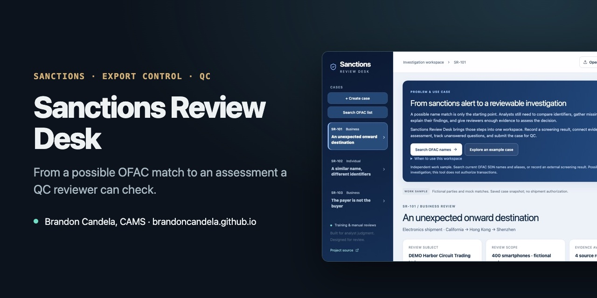

# Sanctions Review Desk



**[▶ Open the live demo](https://brandoncandela.github.io/sanctions-review-desk/)** · [Portfolio](https://brandoncandela.github.io/) · [LinkedIn](https://www.linkedin.com/in/brandon-candela/) · Built by Brandon Candela, CAMS, PMP

> **What this shows:** how a sanctions alert goes from "possible name match" to a documented decision a QC reviewer can check.

## What it does

A screening system says a customer or shipment party might match someone on the OFAC sanctions list. An analyst then has to compare identifiers, ask for missing information, decide and explain the decision. This desk walks through those steps, with a QC review at the end.

It includes three made-up training cases:

- a shipment rerouted from California through Hong Kong to Shenzhen
- an individual whose name resembles a listed person
- a Vietnam-to-China shipment paid for by a third party

You can also search the real OFAC list and open a new case from any result.

## Try it

1. Open the [live demo](https://brandoncandela.github.io/sanctions-review-desk/) and pick a training case.
2. Compare each identifier and mark whether it supports the match, argues against it or is still unknown.
3. Pin the source records that back your view and track the information requests you'd send.
4. Write your assessment and submit it for QC.
5. Switch roles: review the submission, return it with findings, then respond and resubmit.

To search the list, click **Search OFAC list** and type a name.

## How the OFAC search works

A scheduled GitHub Action downloads the official SDN and alias files every hour and saves them in [`data/ofac-sdn.json`](data/ofac-sdn.json). The search runs in your browser against that copy. All words in your query must appear in a name or alias, ignoring accents, punctuation and word order. It doesn't do fuzzy spelling.

If the copy is more than 24 hours old, the search refuses to run rather than give stale results. Each result shows when the data was retrieved. A match is a starting point for review; no match doesn't mean someone is cleared.

## Design choices

- **Unknown is its own answer.** Missing information is tracked as unknown, never counted as a mismatch.
- **Sanctions and export controls stay separate.** A shipment can raise both questions, and the case keeps them apart.
- **Frozen QC snapshots.** Each submission is saved as it was. If the analyst edits afterwards, the old review no longer counts for the new version, and the reviewer sees a before-and-after comparison.
- **Portable case files.** All reviews, custom cases and QC history save to one JSON file that can be reopened later. Files are checked on import, and broken references are rejected.

## Run it locally

Node 22.13 or later and pnpm.

```sh
pnpm install
pnpm dev        # local server
pnpm test       # 21 tests: cases, case files and OFAC search
pnpm build      # static site in pages-dist/
```

| Path | What's in it |
| --- | --- |
| `app/` | The React interface |
| `lib/cases.ts` | Training cases, comparisons, QC rounds and case-file checks |
| `lib/screening.ts`, `lib/screen.ts` | OFAC list parsing and search |
| `scripts/refresh-ofac.mjs` | The hourly OFAC download, run by GitHub Actions |
| `tests/` | Node tests |

## Limits

- The training cases are made up and don't describe real violations. Routing alone doesn't prove anything is prohibited.
- The search covers SDN names and aliases only. It doesn't check ownership (the 50 Percent Rule), other lists, or export classifications.
- Reviewer names are typed in, not real accounts, and case files can be edited by anyone who has them.

Guidance used: [OFAC FAQ 5 on name matches](https://ofac.treasury.gov/faqs/5), [OFAC FAQ 401 on ownership](https://ofac.treasury.gov/faqs/401) and [BIS freight forwarder guidance](https://www.bis.gov/learn-support/export-compliance-programs/freight-forwarder-guidance).

Built with AI coding tools.
